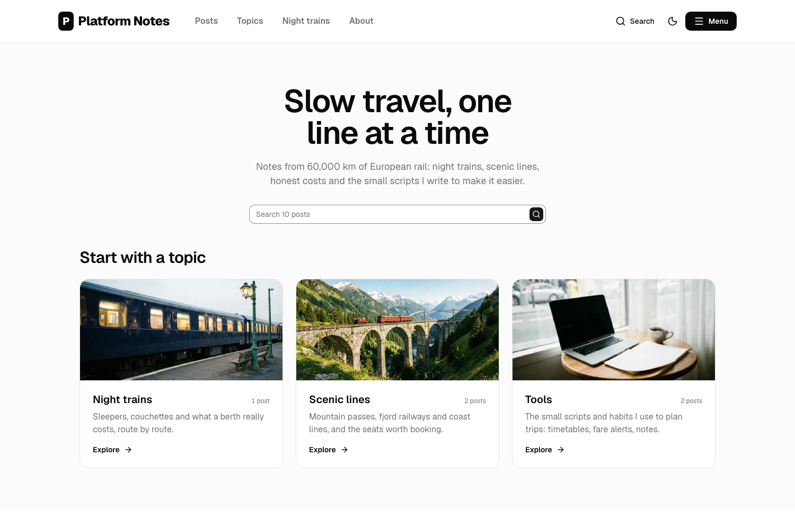

# Quire

A blog theme for Hugo, built with Tailwind CSS v4 and shadcn/ui's design tokens. White pages, Geist type, big photos,
and an article layout made for long reads. It works with Hugo alone: the stylesheet ships prebuilt, so you need no
Node and no npm until you want to add Tailwind classes of your own.



**Demo:** [quire.themes.dev](https://quire.themes.dev/) · **Licence:** MIT

## Features

- **Home page:** a centred intro with search and topic cards, the featured post as a wide card, the three newest
  posts, every tag as a chip, an archive in three staggered columns, and a newsletter sign-up.
- **Posts:** a centred header with byline, date and reading time; a wide cover; the text in a card with "In this
  post" (a table of contents from the second-level headings), a drop cap, pull quotes, tables, figures with
  captions, footnotes and GitHub-style alerts. Then the tags, older and newer posts, an author box, related posts and
  a newsletter form.
- **Lists:** all posts and every tag page as a paginated masonry of story cards; a topics page with a photo per topic.
- **Search:** a search page that reads a JSON index of your posts (no service, no build step).
- **Dark mode** that follows the system, with a switch in the header that remembers the reader's choice.
- **Code:** Chroma highlighting coloured from the theme's tokens in light and dark, and a copy button on every block.
- **Images:** responsive WebP with `srcset` for covers and Markdown images in page bundles or `assets/images/`.
- **Headings** with anchor links, menus from your config, every UI string in `i18n/en.toml`, RSS, sitemap, Open Graph.
- **Accessible:** WCAG 2.2 AA in light and dark (checked with axe at 390 and 1440 px), visible focus rings, a skip
  link, keyboard menus. No layout shift: every image has its size.

## Install

You need Hugo **0.156 or later** (tested with 0.169; the extended edition is not required).

### As a Git submodule

```bash
hugo new site myblog && cd myblog
git init
git submodule add https://github.com/themesdev/hugo-theme-quire.git themes/quire
cp -R themes/quire/exampleSite/. .    # the demo content and config, to start from
hugo server
```

### As a Hugo module

```bash
hugo new site myblog && cd myblog
hugo mod init github.com/you/myblog
```

Then in `hugo.toml`, instead of `theme = "quire"`:

```toml
[module]
  [[module.imports]]
    path = "github.com/themesdev/hugo-theme-quire"
```

and run `hugo mod get -u`. Update later with `hugo mod get -u github.com/themesdev/hugo-theme-quire`.

## Site config

Hugo takes only `[params]` from a theme, so these settings go in **your** `hugo.toml`. `exampleSite/hugo.toml` has them
all, with comments.

```toml
theme = "quire"
titleCaseStyle = "firstupper"   # tags as you write them

[outputs]
  home = ["html", "rss", "json"] # json is the search index

[taxonomies]
  tag = "tags"

[pagination]
  pagerSize = 9

[related]                        # "More from the journal" under a post
  includeNewer = true
  threshold = 20
  toLower = true
  [[related.indices]]
    name = "tags"
    weight = 100
  [[related.indices]]
    name = "date"
    weight = 10

[markup]
  [markup.highlight]
    noClasses = false
  [markup.goldmark.parser]
    wrapStandAloneImageWithinParagraph = false   # an image on its own line becomes a <figure>

# Only needed for params.tailwind = true (see "Your own Tailwind classes"):
[build.buildStats]
  enable = true
[[build.cachebusters]]
  source = "assets/notwatching/hugo_stats\\.json"
  target = "css"
[module]
  [[module.mounts]]
    source = "assets"
    target = "assets"
  [[module.mounts]]
    disableWatch = true
    source = "hugo_stats.json"
    target = "assets/notwatching/hugo_stats.json"
[security.exec]
  allow = ['^(dart-)?sass$', '^go$', '^git$', '^node$', '^postcss$', '^tailwindcss$']
```

## Params

| Param | What it does |
|---|---|
| `description` | The site's description (meta tags, footer tagline fallback). |
| `mainSections` | The sections whose pages are posts. Default `["posts"]`. |
| `date_format`, `date_format_short` | Hugo date layouts for posts and cards. Default `:date_long` and `:date_medium`. Set the site's `locale` (for example `en-GB`) for the date order. |
| `toc_min_headings` | Show "In this post" when a post has at least this many `##` headings. Default 3. |
| `show_credit` | The "Theme: Quire by themes.dev" line in the footer. Default `true`. |
| `tailwind` | Compile `assets/css/main.css` with Tailwind instead of using the prebuilt CSS. Default `false`. |
| `nav_limit` | How many main-menu items show in the header bar on large screens (all are in the menu drawer). Default 4. |
| `brand.mark`, `brand.logo`, `brand.note` | The letter in the square beside the site name, or a logo file in `assets/images/` instead; a line under the menu drawer. |
| `author.*` | The default author: `name`, `role`, `bio`, `note`, `href`, `photo` (a file in `assets/images/`), `links` (`[{label, href}]`). |
| `home.*` | The home page's words: `title`, `lead`, `search_placeholder`, `topics_label`, `topics` (tag slugs for the topic cards), `latest_kicker`, `latest_title`, `latest_body`, `more_kicker`, `more_title`, `more_body`. |
| `newsletter.*` | `action` (your mailing service's form URL; empty hides every form), `method`, `name`, `kicker`, `title`, `body`, `submit`, `legal`, `privacy` (`{label, href}`), `readers`, `benefits` (list), `photo` and `stats` (the form under posts), `issue` (the card on the home page: `number`, `date`, `title`, `photo`, `contents`, `link`). |
| `footer.*` | `tagline`, `note` (Markdown), `copyright`. |
| `social` | `[{label, href}]`, shown as pills in the footer next to RSS. |
| `related_intro` | A line under "More from the journal". |
| `og_image`, `favicon`, `noindex` | A default share image (in `assets/images/`), a favicon path, and a switch to keep the site out of search engines. |

**Menus:** `main` (header and drawer), `footer` and `legal` (the footer's two rows).

**Multiple authors:** add `data/authors/<key>.yaml` with the same fields as `params.author`, and put `author: <key>` in
a post's front matter.

## Front matter

```yaml
---
title: "The Bergen line in winter"
date: 2026-11-01
description: "One or two sentences: the standfirst under the title, the card summary and the meta description."
tags: [Norway, Scenic lines]
cover:
  src: cover.webp     # next to index.md in a page bundle, or a path under assets/images/
  alt: "A red train crossing a snowy plateau."
featured: true        # the wide card on the home page (else the newest post)
kicker: "Winter"      # the small label over the title (else the first tag)
toc: false            # hide "In this post"; true shows it with fewer headings
author: sam           # data/authors/sam.yaml instead of params.author
---
```

A tag page takes `content/tags/<tag>/_index.md` with a `title`, a `description` and a `cover`: that photo shows on
the topic cards (otherwise the cover of the tag's newest post does).

Markdown extras: `` on its own line is a figure; `> A quote` is a pull quote;
`> [!NOTE]` (or TIP, IMPORTANT, WARNING, CAUTION) is an alert box; footnotes with `[^1]`.

## Colours and type

Every colour in the theme is a shadcn/ui token. To change the look, copy `assets/css/main.css` from the theme into your
site's `assets/css/main.css` and change the values under `:root` (light) and `.dark` (dark):

```css
:root {
  --background: oklch(1 0 0);
  --foreground: oklch(0.145 0 0);
  --primary: oklch(0.205 0 0);
  --muted: oklch(0.97 0 0);
  --muted-foreground: oklch(0.556 0 0);
  --border: oklch(0.922 0 0);
  --radius: 0.625rem;
  /* … */
}
```

Then set `params.tailwind = true` (below), or rebuild the prebuilt stylesheet with the Tailwind CLI. Code colours use
`--info`, `--success`, `--warning` and `--muted-foreground`. Fonts are Geist and Geist Mono, self-hosted in
`static/fonts/` (`assets/css/fonts.css`).

## Your own Tailwind classes

By default Quire uses `assets/css/compiled.css`, built from every class the theme uses. To add classes of your own
(in your layouts, shortcodes or Markdown attributes):

1. `npm install -D tailwindcss @tailwindcss/cli` in your site (Node 22+; use npm, not pnpm: pnpm's layout has an open
   Hugo issue).
2. Add the `build`, `module` and `security` settings from "Site config".
3. Set `tailwind = true` under `[params]`.

Hugo then compiles `assets/css/main.css` with Tailwind v4 after rendering every page, scanning `hugo_stats.json`.

## Credits

- **Fonts:** [Geist and Geist Mono](https://vercel.com/font) by Vercel, SIL Open Font License 1.1 (`static/fonts/Geist-OFL.txt`).
- **Icons:** [Lucide](https://lucide.dev), ISC licence.
- **Photos** in `exampleSite/` are AI-generated (FLUX.2 by Black Forest Labs, through Cloudflare Workers AI) for this
  demo, and made only for Quire: the person in the portrait is invented and the scenes are generated, not photographs of
  real places. Use them in your own site freely; they are covered by the MIT licence of this theme.
- **Animations:** `assets/css/vendor/tw-animate.css` (MIT).
- The demo blog, Platform Notes, and its author are made up.

## More from themes.dev

Quire is free and made by [themes.dev](https://www.themes.dev/?utm_source=hugo-themes&utm_medium=referral&utm_campaign=quire).
If you build sites with React, [UI Pro](https://www.themes.dev/pricing/?utm_source=hugo-themes&utm_medium=referral&utm_campaign=quire)
is our library of shadcn/ui blocks and complete themes for Astro and Next.js, and it includes a Hugo edition of the
Galley theme.

## Licence

MIT, © 2026 themes.dev. See [LICENSE](LICENSE).
