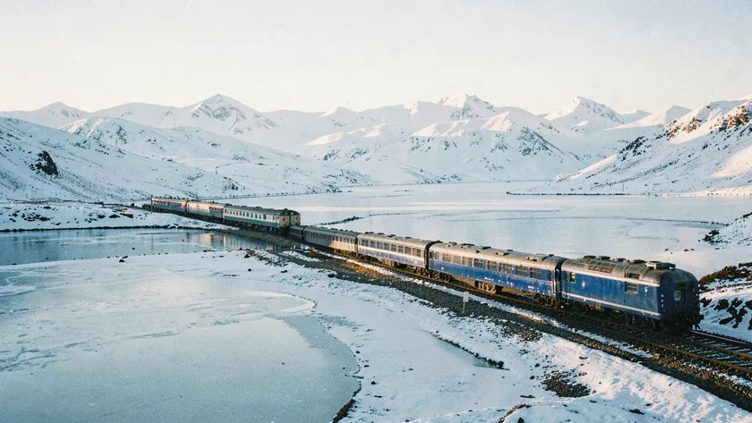
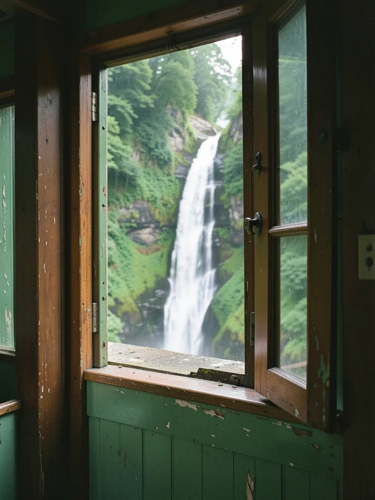

Oslo to Bergen takes six and a half hours and climbs to 1,222 metres at Finse, the highest station on the Norwegian main lines. In summer you share the view with hikers. In December you share it with almost nobody.

## Book the right seat

Seat reservations are compulsory and cost NOK 50 on top of the ticket. Ask for the **left side** heading west: the Hallingskarvet massif and the frozen lakes are on that side for the best hour of the trip. Comfort class (NOK 250 more) gets you free coffee and a quiet car, and on a winter morning I would pay it again.

## Finse

The train stops here for two minutes. Get off the day before instead: the hotel next to the platform has 44 rooms, a sauna and nothing else for twenty kilometres. There is no road.

## The Flåm detour

Change at Myrdal for the Flåm railway, 20 km and 866 metres down to the end of a fjord. In winter it runs four times a day instead of ten. Sit on the right going down, and stand up when the train stops at the Kjosfossen waterfall.

## What to pack

- A layer you can take off: Norwegian trains are warm.
- Food. The café car closes at Finse when the train is late, and in winter it often is.
- A power bank. Sockets are at every seat in comfort, not in standard.

## Is December worth it?

Yes, if you want the snow and do not mind four hours of daylight. The train runs through the dark on both ends of the trip, and the plateau in the middle is the brightest thing you will see all week.
