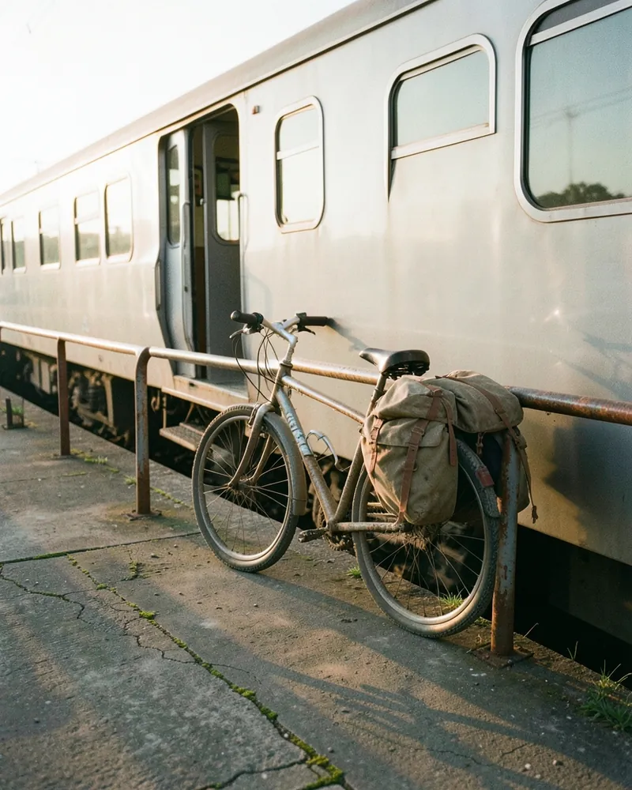

A bike makes a rail trip twice as useful: you get off at the small station and ride the last twenty kilometres. It also makes booking three times as hard. Here is what I learned crossing nine countries with a loaded touring bike.

## Regional trains: mostly easy

In the Netherlands, Germany, Austria, Switzerland and Italy, regional trains take bikes with a bike ticket and no reservation. The ticket costs €6 a day in Germany, €7.50 a day in the Netherlands (not in rush hour) and €3.50 a journey in Italy. Look for the bike symbol on the door and stand by it on the platform.

## Long-distance trains: book a space

ICE, Railjet and Frecciarossa trains have a few bike spaces each, and you must reserve one. They sell out on summer weekends weeks ahead. If a space is gone, a regional train an hour slower will still take you.

## Night trains

Nightjet carries bikes on most routes for €15, in a separate van, with a reservation. You hand the bike over at the platform and get it back in the morning, which feels strange the first time and is fine.

## The awkward ones

- **France**: TGV trains only take a bike in a bag, wheels off. Regional TER trains take them whole and free, but only a few per train.
- **Spain**: long-distance trains take a bike in a bag; regional trains vary by region.
- **The UK**: free on most trains, reservations on the long-distance ones, and some operators take only two bikes per train.

## What I would do again

Carry a light bike bag (mine weighs 400 g) so that a TGV is never a dead end, and book the night train bike space before anything else.
