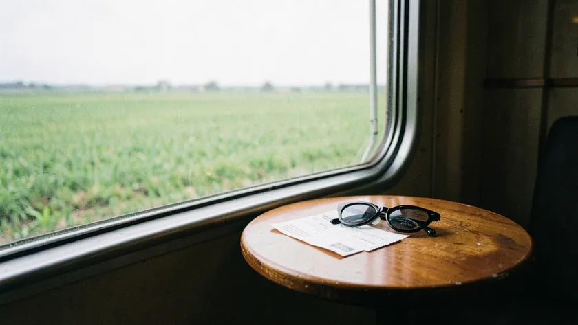

The question I get most by email is whether a rail pass is worth it. The honest answer is that it depends on two numbers: how many long days you travel, and how much the seat reservations add. So I priced three real trips both ways.

## The pass

A Global Pass for 7 travel days in one month costs €335 for an adult in second class this year. It covers the train, not the seat: most high-speed and night trains need a reservation on top, from €10 for an Italian Frecciarossa to €39 for a French TGV at a busy hour.

## Three trips, priced both ways

| Trip | Travel days | Single tickets | Pass + reservations |
|---|---|---|---|
| Vienna, Venice, Florence, Rome, Naples | 5 | €214 | €335 + €41 |
| London, Paris, Barcelona, Lyon, Geneva, Zurich | 7 | €512 | €335 + €118 |
| Copenhagen, Stockholm, Oslo, Bergen, Narvik | 7 | €468 | €335 + €62 |

Single tickets were booked six weeks ahead, the cheapest fare I could find on each operator's own site.

## Where the pass wins

On the Scandinavian trip, by €71, because Norwegian and Swedish trains have cheap reservations and expensive walk-up fares. It also wins whenever you do not know your dates: single tickets bought the week before cost about double.

## Where it loses

In Italy, by a wide margin. Trenitalia and Italo sell advance fares at €9.90 that no pass can beat. And on the London to Geneva trip the Eurostar and TGV reservations ate most of the saving.

## My rule

A pass pays when you have five or more long travel days, at least one of them in Scandinavia or Switzerland, and you want to keep your dates open. Otherwise, book singles early.
