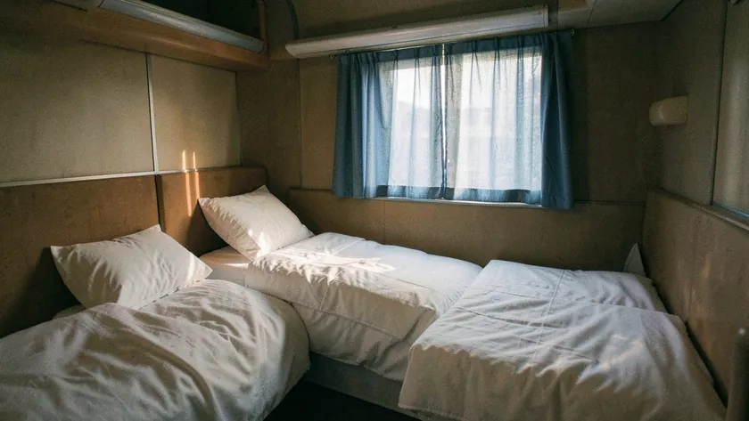

Every night train sells three ways to lie down: a seat, a couchette and a sleeper. The price gap between them is wider than it looks on the booking page, because the cheap options leave things out. This autumn I rode four routes and wrote down every euro.

## What you get for the money

A **couchette** is a bunk in a compartment of four or six, with a sheet, a pillow and a blanket. You share with strangers, you keep your shoes on the floor, and you are woken at the border. A **sleeper** is a proper bed in a compartment for one to three, with a washbasin, a towel and usually breakfast.

The middle option, a four-berth couchette booked for fewer people, is the one I now use most. Book the whole compartment for two and you pay less than a double sleeper with far more room.

## Four routes, priced

| Route | Couchette (6) | Couchette (4) | Sleeper (single) |
|---|---|---|---|
| Vienna to Rome | €69 | €89 | €219 |
| Zurich to Hamburg | €59 | €79 | €189 |
| Brussels to Prague | €79 | €99 | €229 |
| Stockholm to Narvik | €62 | – | €148 |

Prices are what I paid in September and October 2026, booked four to six weeks ahead, for one adult.

## The supplements nobody mentions

- **Breakfast** is included in sleepers and in most four-berth couchettes, but not in the six-berth ones. Bring something; the station kiosks are shut at six.
- **Women-only compartments** cost nothing extra on Nightjet. Tick the box when you book.
- **Private use** of a couchette compartment is a separate fare, not a supplement, and it only shows up when you search for the exact number of travellers.

## Which one I book now

For one night, a four-berth couchette. For two nights in a row, a sleeper for the second one: by then a door that locks and a basin are worth every euro.
