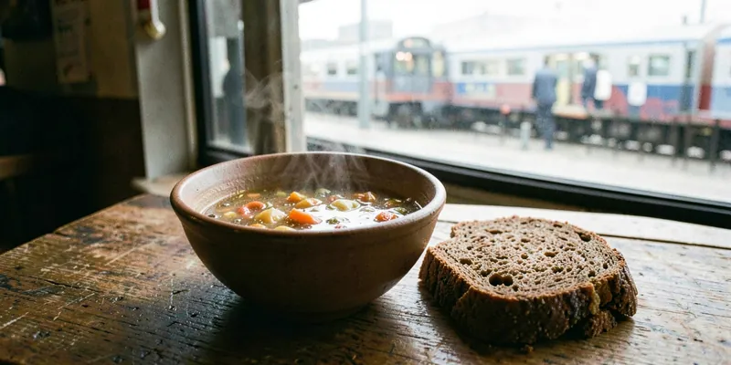

A missed connection is only a problem if the station is bad. These are the eight where I have been glad of the extra hour, in the order I would go back.

## 1. Bologna Centrale, the bar on platform 1

Standing room only, a counter of brioche filled to order and an espresso for €1.20. The barista knows the delays before the departure board does.

## 2. Basel SBB, the buffet in the French hall

A proper dining room with white cloths, rösti for CHF 19 and a view of the night trains to Hamburg pulling in. It closes at nine; the trains do not.

## 3. Trieste Centrale

Fish soup with bread, €9, in a room that has not been redecorated since 1957. Reopened in September after a year shut.

## 4. Milano Centrale, upstairs

Ignore the chains on the concourse and take the escalator to the gallery. The small bar at the east end does a tramezzino for €3 and has chairs.

## 5. Innsbruck Hbf

Apple strudel, warm, with a view of the mountains through the glass roof. Good for the hour between the Brenner trains.

## 6. Zürich HB, the kiosk by track 3

Not a café: a kiosk with the best Bircher muesli in Switzerland, in a jar you can take on the train. CHF 6.80.

## 7. Verona Porta Nuova

A small bar opposite the ticket hall that bakes its own focaccia at five in the morning. Worth catching the early train for.

## 8. Lyon Part-Dieu

The only French station on the list, for a café crème and a praline brioche at the bakery stall on the lower level.

## What makes a good one

Seats, a view of the departure board and food made in the building. Most of these have all three. None of them takes a reservation.
