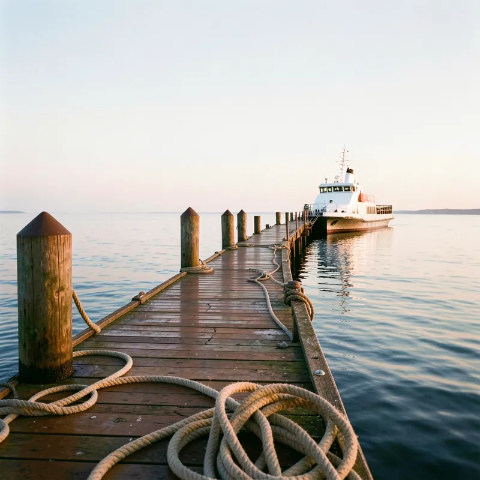

Gotland is three hours by ferry from the Swedish mainland, and the ferry port is a short train ride from Stockholm. Done right, you leave the capital after breakfast and eat dinner inside the walls of Visby.

## The connection

Take the commuter train from Stockholm City to Nynäshamn, an hour south. It runs every half hour and costs SEK 63 with an SL card. The ferry terminal is a four-minute walk from the last stop.

| From Stockholm City | Arrive Nynäshamn | Ferry departs | Arrive Visby |
|---|---|---|---|
| 07:12 | 08:10 | 09:00 | 12:15 |
| 13:42 | 14:40 | 15:30 | 18:45 |
| 17:12 | 18:10 | 19:30 | 22:45 |

Leave at least forty minutes between train and ferry: the boarding gates close twenty minutes before sailing.

## On the boat

Foot passengers pay from SEK 290 one way. Book a seat in the quiet lounge at the front for SEK 120 more; the open deck at the back is the place to be for the last half hour, when the island comes up out of the sea.

## In Visby

The old town is small enough to walk across in fifteen minutes and has more ruined churches than seems reasonable. Hire a bike for the rest of the island; the coast road north to Fårö is flat and quiet out of season.

## When to go

Late September. The ferries still run four times a day, the rooms cost half of what they did in July, and the island is yours.
